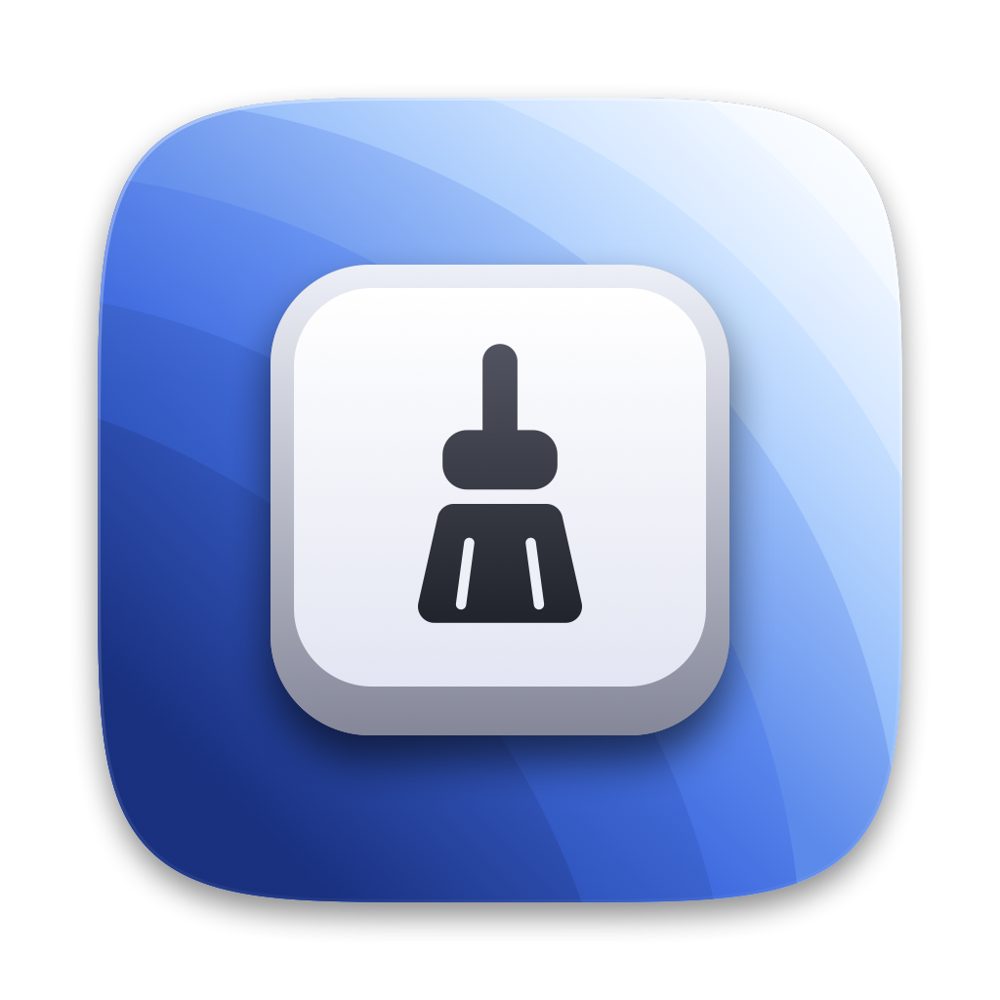
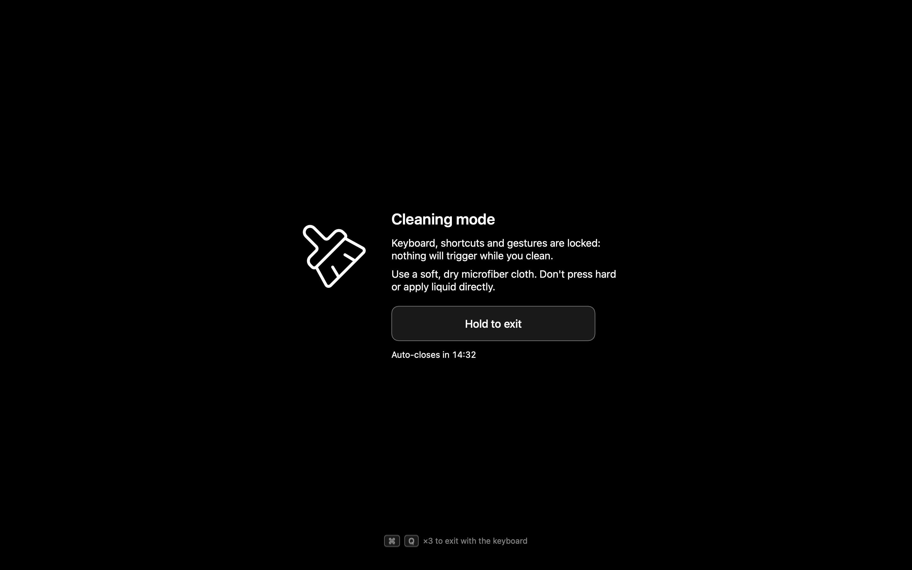
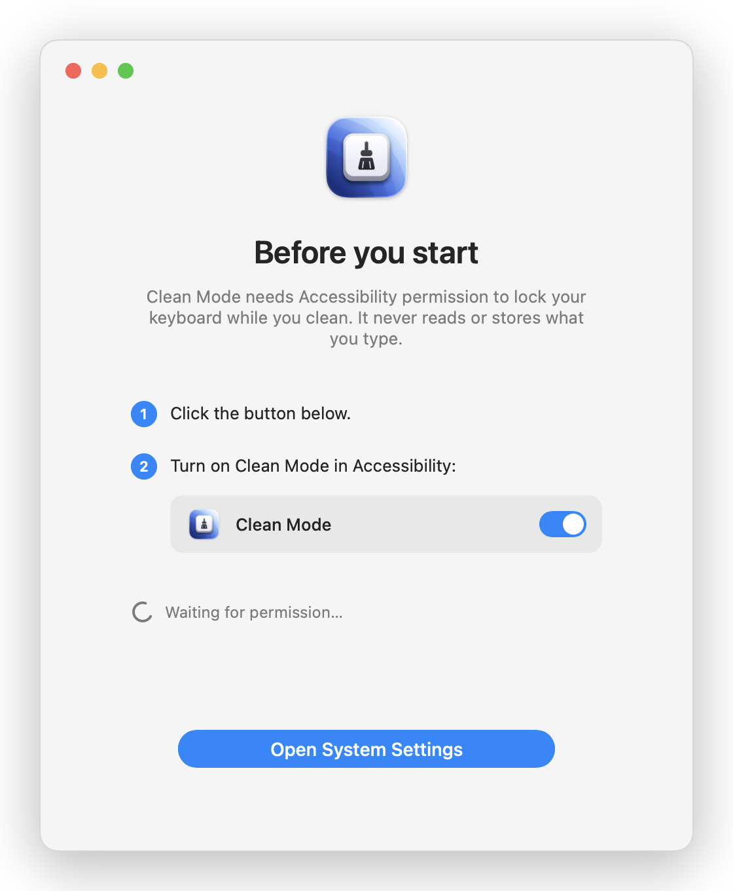

<p align="center">
  
</p>

<h1 align="center">Clean Mode</h1>

<p align="center">
  Lock your Mac's keyboard, shortcuts and screen while you clean it.<br>
  Wipe everything down without opening apps, changing settings or putting the Mac to sleep by accident.
</p>

<p align="center">
  <a href="https://github.com/YOUR_GITHUB_USER/cleanmode/releases/latest"><strong>⬇️ Download for macOS</strong></a>
  &nbsp;·&nbsp;
  <a href="#build-from-source">Build from source</a>
  &nbsp;·&nbsp;
  <a href="CONTRIBUTING.md">Contribute</a>
</p>

<p align="center">
  
  
  
  
</p>

<p align="center">
  
</p>

<p align="center">
  <picture>
    <source media="(prefers-color-scheme: dark)" srcset="docs/screenshots/onboarding-dark.png">
    
  </picture>
</p>

<p align="center"><sub>The lock screen and the first-run onboarding.</sub></p>

---

## The problem

Cleaning a laptop is surprisingly risky. Wiping the keyboard presses every key; wiping the trackpad fires gestures; touching the screen at the wrong moment closes windows. In a few seconds you can:

- type garbage into whatever app is focused,
- trigger shortcuts (quit, close, delete, Mission Control, Spotlight…),
- change volume or brightness, or toggle settings,
- put the Mac to sleep or log out.

The usual workaround is to shut the Mac down first, which is slow and means you can't see the dust you're wiping off a lit screen.

## What Clean Mode does

Open it and everything gets locked, while the screen stays on and black so you can see exactly where you've cleaned:

- **Keyboard locked**: every key, including media / volume / brightness keys, is swallowed.
- **Shortcuts and gestures locked**: Cmd+Tab, Cmd+Q, force quit, Dock, menu bar and most trackpad gestures are disabled.
- **Black screen on every display**, so smudges and dust are easy to spot.
- **Custom cursor**: the real cursor is hidden and replaced by a circle with a smooth trail. The mouse keeps working so you can use the exit button.
- **Display stays awake** while it's active.
- **Hold-to-exit button**: hold it for 3 seconds to leave.
- **Never get stuck**: three independent ways out (below).
- **13 languages**, picked automatically from your system.

### Three ways out

| Exit | How |
| --- | --- |
| Button | Hold the on-screen button for 3 s |
| Keyboard | Press <kbd>⌘</kbd> <kbd>Q</kbd> three times (the count resets if you pause) |
| Timeout | Closes by itself after 15 minutes (configurable) |

If the app ever crashes, the keyboard lock disappears with it.

### What it can't do

Software can't block everything:

- The **power button / Touch ID key**: a long press still powers the Mac off. Avoid it while cleaning.
- **Closing the lid** puts the Mac to sleep as usual.
- A few system-level trackpad gestures may still get through on some macOS versions. If you find one, please [open an issue](../../issues).

## Install

1. Download `CleanMode-x.y.z.zip` from the [latest release](https://github.com/YOUR_GITHUB_USER/cleanmode/releases/latest) and unzip it.
2. Move `CleanMode.app` to `/Applications`.
3. Open it. On first launch Clean Mode walks you through granting the **Accessibility** permission (macOS requires it to be able to block the keyboard) and starts as soon as it's active.

> **"Apple could not verify…" warning?** Releases are not notarized yet. Open **System Settings → Privacy & Security**, scroll to the message about Clean Mode and click **Open Anyway**. Or from Terminal:
> ```bash
> xattr -dr com.apple.quarantine /Applications/CleanMode.app
> ```

### Options

```bash
# Try it for one minute first
open /Applications/CleanMode.app --args --timeout=1

# Change the auto-close time (minutes; 0 or less disables it)
defaults write im.dnn.cleanmode timeoutMinutes -int 20

# Force a language
open /Applications/CleanMode.app --args --lang=ja
```

## Privacy

Clean Mode needs the Accessibility permission only to be able to intercept the keyboard and throw the keystrokes away.

- It **does not log, store or transmit** what you type. Every key is discarded; the only thing it looks at is whether you pressed ⌘Q, to count the emergency exit.
- It **makes no network requests** and has no analytics.
- It's open source: read `Sources/CleanMode/KeyboardBlocker.swift`.
- You can revoke the permission any time in System Settings → Privacy & Security → Accessibility.

## Languages

English, Español, 中文, हिन्दी, العربية (right-to-left), Français, Português, Русский, বাংলা, 日本語, Deutsch, Italiano, 한국어. The language follows your system preferences and falls back to English. Translations are a great first contribution, see [CONTRIBUTING.md](CONTRIBUTING.md#translations).

## Build from source

Requirements: macOS 13+, Swift 5.9+ (Xcode or the Command Line Tools). Full Xcode is optional but recommended: it's used to compile the app icon catalog (`actool`).

```bash
git clone https://github.com/YOUR_GITHUB_USER/cleanmode.git
cd cleanmode

./scripts/build-app.sh        # builds, assembles and signs build/CleanMode.app
open build/CleanMode.app --args --timeout=1
```

Notes:

- The build is **ad hoc signed** by default. macOS ties the Accessibility permission to the signature, so each rebuild asks for it again. Sign with your own certificate to keep it:
  ```bash
  CODESIGN_IDENTITY="Apple Development: Your Name (TEAMID)" ./scripts/build-app.sh
  ```
  (`security find-identity -p codesigning -v` lists your identities.)
- Reset the permission while testing the onboarding: `tccutil reset Accessibility im.dnn.cleanmode`.
- Regenerate the icon: `./scripts/make-icon.sh` (drawn with CoreGraphics in `scripts/make-icon.swift`).
- Build a release zip + checksum: `./scripts/package.sh`.
- Regenerate the README screenshots (renders the SwiftUI views to PNG; it does not lock anything): `build/CleanMode.app/Contents/MacOS/CleanMode --render-docs=docs/screenshots --lang=en`.

> ⚠️ The app takes over your keyboard and screen. Always test with a short `--timeout`.

### Project layout

| Path | What's there |
| --- | --- |
| `Sources/CleanMode/LockController.swift` | Orchestrates the lock: windows, keyboard, cursor, sleep, timeout |
| `Sources/CleanMode/KeyboardBlocker.swift` | The `CGEventTap` that swallows input and counts ⌘Q |
| `Sources/CleanMode/OverlayView.swift` | Lock screen UI and the hold-to-exit button |
| `Sources/CleanMode/CursorTrailView.swift` | Custom cursor and trail |
| `Sources/CleanMode/Onboarding*.swift`, `Permissions.swift` | Accessibility onboarding and permission checks |
| `Sources/CleanMode/Localization.swift` | All strings, 13 languages |
| `scripts/` | Build, icon and packaging scripts |

## Contributing

Bug reports, translations and pull requests are welcome. Please read [CONTRIBUTING.md](CONTRIBUTING.md) and the [Code of Conduct](CODE_OF_CONDUCT.md). For security issues see [SECURITY.md](SECURITY.md). Maintainers: [docs/RELEASING.md](docs/RELEASING.md).

## Acknowledgements

- The cleaning-mode idea and the broom icon come from the sibling project **aura**. The icon is [Lucide](https://lucide.dev)'s `brush-cleaning` (ISC License).
- The cursor trail is inspired by the "Cascading Dots" effect in [Cursor Lab](https://cursor-lab-ui.vercel.app/).

## License

[MIT](LICENSE) © Daniel Garcia
